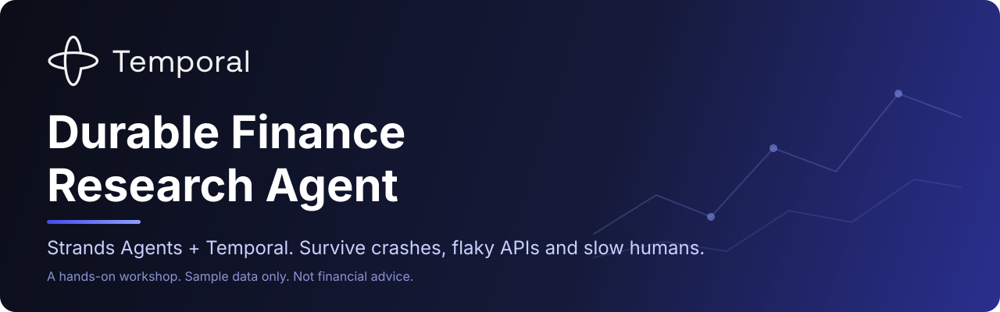
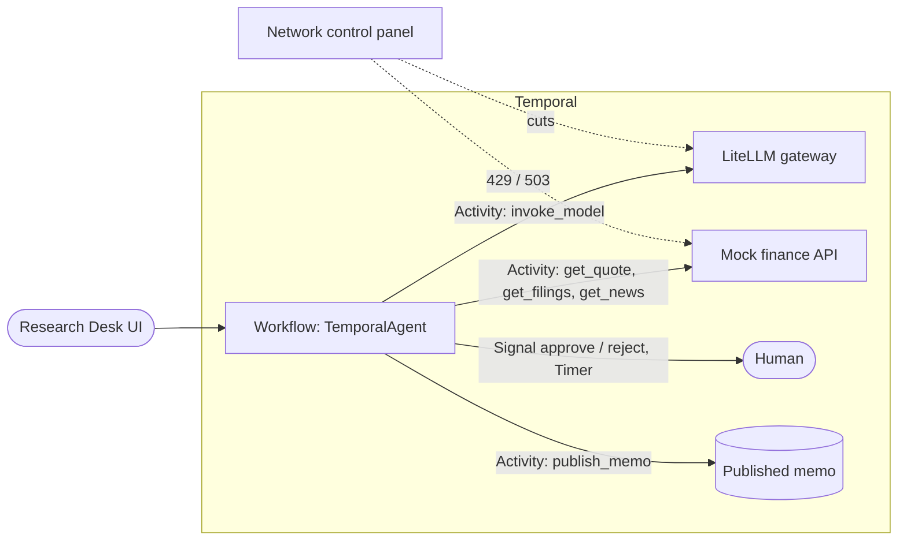

<div align="center">

<a href="https://temporal.io"></a>

<br>

[](https://temporal.io)
[](https://strandsagents.com)
[](https://www.python.org)
[](https://docs.astral.sh/uv/)
[](https://www.docker.com)
[](LICENSE)
[](https://t.mp/slack)

**[Temporal.io](https://temporal.io)** &nbsp;|&nbsp; **[Docs](https://docs.temporal.io)** &nbsp;|&nbsp; **[Python SDK](https://docs.temporal.io/develop/python)** &nbsp;|&nbsp; **[Strands + Temporal guide](https://docs.temporal.io/develop/python/integrations/strands-agents)** &nbsp;|&nbsp; **[Community](https://t.mp/slack)**

</div>

---

A hands-on [Temporal](https://temporal.io) workshop. You build a finance research agent with
[Strands Agents](https://strandsagents.com): it fans out to market data, filings and news, drafts a memo, and waits
for a human to approve it. Then you make it survive crashes, flaky APIs and slow humans by running it on Temporal.

> [!IMPORTANT]
> **For demo purposes only. None of this data is real.** The three demo tickers (TWS for TrainWithShubham, KAVERI for
> Kaveri Labs, CLOUD for CloudAdhar) are not publicly listed companies. The tickers are invented, and every price, ratio,
> filing and headline is invented too. Do not use any output for investment decisions.
> Nothing in this repo is financial advice.

## What you will learn

<table>
<tr>
<td width="33%" valign="top">

### 1. Build the agent
A Strands agent with a model, a prompt and a tool, served through a LiteLLM gateway.

**Break It:** cut the gateway and watch the script die.

</td>
<td width="33%" valign="top">

### 2. Give it a job
Three finance tools (quote, filings, news) and a research brief that writes a sourced memo.

**Break It:** break the data API. The run is lost and paid work repeats.

</td>
<td width="33%" valign="top">

### 3. Make it durable
Run it as a Temporal Workflow. Close three gaps: error classification, an approval Signal with a timeout, an idempotent publish.

**Break It:** `pkill -9` the worker, rate-limit the API, let the approval time out.

</td>
</tr>
</table>

Module 3 uses the Temporal Strands integration (`temporalio.contrib.strands`, Public Preview). Model calls and tool
calls become Activities, and an approval Signal plus a Timer holds the memo until a human decides.



## Quickstart

You need an OpenAI-compatible LLM endpoint. Any [LiteLLM](https://docs.litellm.ai) gateway works.

```bash
git clone https://github.com/temporal-community/durable-finance-research-agent.git
cd durable-finance-research-agent
cp .env.example .env        # set LITELLM_API_BASE, LITELLM_API_KEY, MODEL_ID
just doctor                 # checks tools, ports and the LLM, prints the fix for anything wrong
just up                     # starts the stack
```

Then open the **Research Desk** at http://localhost:8000.

## Run it yourself (self-hosted)

Two equal ways to run the stack. Pick one, not both at once.

| | `uv` (native) | Docker |
|---|---|---|
| Needs | [uv](https://docs.astral.sh/uv/), [Temporal CLI](https://docs.temporal.io/cli), [just](https://just.systems) | [Docker](https://www.docker.com) |
| Start | `just up` | `just up-docker` |
| Run modules | on your machine | `docker compose exec workshop bash`, then the same commands |
| Stop | `just down` | `just down-docker` |

Install the prerequisites on macOS: `brew install uv temporal just`. Python 3.12+ is provided by `uv`.

Run the modules:

```bash
just m1 "Price moved from 98.2 to 112.4. What is the percent change?"   # module 1
just m2 "Write a research memo on TWS."                                # module 2
just worker                                                             # module 3, terminal 1
just start "Write a research memo on TWS."                             # module 3, terminal 2
just approve <workflow-id>                                              # or use the Research Desk UI
just test 3                                                             # offline tests, no key needed
```

Each module has `exercise/` (starter code with `TODO` blocks to uncomment) and `solution/`. Run the finished code
instead of your exercise with `VARIANT=solution just m1 ...`.

| Where | What |
|---|---|
| http://localhost:8000 | **Research Desk**: run modules 1, 2 and 3, approve or reject memos |
| http://localhost:5050 | **Network control panel**: cut the LLM gateway, break the data API |
| http://localhost:8233 | **Temporal UI**: Event History, pending Activities, Signals, Timers |

There is no editor tab when you run it yourself: edit the `TODO` blocks in your own editor. On Linux, the Docker path
runs as root, so `published/` and `.run/` end up root-owned in your checkout.

The control panel's LLM toggle works through a local mitmproxy that `just m1`, `just m2`, `just worker` and `just start`
route through. It uses port 5050, not 5000, because macOS AirPlay already owns 5000.

## Repository layout

```
modules/01-strands-agent-basics/            exercise/ + solution/
modules/02-strands-finance-research-agent/  exercise/ + solution/
modules/03-durable-strands-agent/           exercise/ + solution/
shared/    mock-finance-api/  netplane/ (proxy + control panel)  ui/ (Research Desk)
sandbox/   Dockerfile and bootstrap for the hosted lab image
instruqt/  the hosted lab track (optional, see below)
```

<details>
<summary><b>The hosted Instruqt lab, and maintainer notes</b></summary>

<br>

### Instruqt track

The track lives in `instruqt/`. The sandbox image (`sandbox/Dockerfile`, published as `trainwithshubham/durable-finance-research-agent-sandbox` on Docker Hub, public) bakes the workshop source at `/opt/workshop`;
`sandbox/bootstrap-workshop.sh` stages it to `/root/workshop`, mints a learner-scoped LiteLLM key through the secret
broker (secret `TEMPORAL_LITELLM_BROKER_SECRET`), and starts the same stack that `just up` starts.

```
instruqt/
  track.yml  config.yml
  track_scripts/{setup,cleanup}-workshop
  01-strands-agent-basics/            assignment.md + setup/check/solve/cleanup-workshop
  02-strands-finance-research-agent/
  03-durable-strands-agent/
sandbox/    Dockerfile, bootstrap-workshop.sh
```

There is no Solution tab. The Editor tab (code-server, port 8080) opens the workshop root, so `solution/` sits next to `exercise/` in the file tree.

Tabs per challenge (button numbers are 0-based):

| Challenge | Tabs |
|---|---|
| 1 and 2 | Editor, Terminal, Research Desk, Network Control Panel |
| 3 | Editor, Worker, Starter, Research Desk, Temporal UI, Network Control Panel |

Network control panel:

| Toggle | Effect |
|---|---|
| LLM gateway | The proxy answers 503 for the LiteLLM host |
| Market data API | `ok`, `unavailable` (503) or `rate limited` (429 with `Retry-After: 2`) |
| Kill all | The proxy answers 503 for every proxied host |

Track commands (need the Instruqt CLI and `instruqt auth login`): `just validate`, `just pull`, `just diff`. `just create` and `just push` publish to Instruqt. Run them deliberately.

Local checks before any push:

```bash
just validate
uv run python scripts/check_exercises.py .     # every exercise goes green once its TODOs are uncommented
```

The per-sandbox Temporal dev server means attendees do not share task queues, so per-attendee Workflow IDs are not needed.

### Known issues

- The Strands plugin for Temporal is Public Preview. `temporalio` and `strands-agents` are pinned to a minor version in
  `pyproject.toml`. The docs show `temporalio.contrib.strands`; a standalone `temporalio-strands-agents` package also exists.
  Check which import path your pinned version exposes before bumping.
- LiteLLM's `litellm_proxy` provider posts to `{LITELLM_API_BASE}/chat/completions` (it does not add `/v1`).
- Traffic to `127.0.0.1` and `localhost` bypasses the proxy (`NO_PROXY`), so the LLM toggle only cuts a gateway on another host.
  `just doctor` warns about this. From Docker, reach a gateway on your machine as `http://host.docker.internal:<port>`.
- The model Activity retries without a limit on purpose, so an LLM outage leaves the Workflow Running. Tool Activities stop
  after two minutes.
- `publish_memo` writes a file and stands in for an email or CMS call. Its idempotency key dedupes within one Workflow ID only.
- Unverified until first run on Instruqt: the variable names the secret broker writes to `/root/.litellm-env`, and TLS trust for
  the mitmproxy CA from Python clients.

</details>

## Contributing and support

Issues and pull requests are welcome. Ask questions in the [Temporal community Slack](https://t.mp/slack) or the
[Temporal forum](https://community.temporal.io).

## Author

**Shubham Londhe**, Developer Advocate at [Temporal](https://temporal.io).
[LinkedIn](https://www.linkedin.com/in/shubhamlondhe1996) | [GitHub](https://github.com/LondheShubham153)

## License

[MIT](LICENSE). All market data, filings and news in this repository are invented sample data. The companies are not publicly listed and the tickers are invented.
